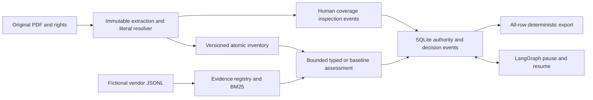

# Architecture and boundaries

The local Python CLI/TUI imports a rights-permitted native-text PDF and fictional
vendor JSONL, inventories obligations, retrieves registered evidence and records
explicit review decisions. The selected optional local browser reviewer has source-only backend, application, presenter, template and CSS seams; no listener or browser has run.
Construction source has not been exercised at runtime.

`contracts/` owns strict versioned wires. `source/` owns immutable extraction,
original Unicode-codepoint intervals, normalization alignment and literal
resolvers. `evidence/` owns fictional corpus generations, BM25 and conservative
assessment. `providers/` owns typed question ports and explicit unavailable
outcomes; live source adapters are lazy and gated. No model is an actor, permission
grant or decision maker. `review/` owns the authoritative SQLite domain ledger,
exact-generation decisions, source/corpus invalidation and LangGraph reconciliation.
`export/` builds HTML/CSV/Markdown and manifests without hiding unresolved rows.
The CLI and TUI use those same services.

Raw PDF hash, extracted artifact hash, parser/normalizer identity, requirement
revision, corpus generation, assessment generation and human decision are distinct.
An edit creates pending work. Positive approval requires current complete validated
support; gap acknowledgment does not promise compliance. Old generations and
exports remain history. Original artifacts are immutable: coverage decisions
are separate versioned events, not rewritten parser facts. Actor authentication,
CAS/idempotency, recovery, checkpoint compatibility and backup consistency remain
runtime validation obligations.

Evaluation is separate from the reviewer. `src/rfp_matrix/eval/scoring.py` accepts explicit
development packets and adjudicated one-to-one matches. `src/rfp_matrix/eval/runner.py` freezes
identical public inputs for B0a/B0b/F1/F2 and accepts only injected fake/baseline/
replay ports in this construction boundary. The external custodian owns private
gold, independently adjudicated equivalence, seal authentication, durable spent-set
consumption and confirmatory scoring. Public receipts expose bounded aggregate
counts with unmeasured/N/A states. `src/rfp_matrix/eval/corpus.py` prepares rights revisions and
checks family mappings/annotation structure; it creates no corpus permission or
human custody. See [corpus workflow](eval/CORPUS-WORKFLOW.md).

The product imports no private gold, discovers no held-out directory and treats
source/provider text as untrusted data. No runtime security/isolation guarantee
follows from static source inspection. Exact dependency resolution, real parser,
SQLite/LangGraph/provider seams, restart races and real corpus/model evaluation
must be activated and verified separately.

## Optional browser and amendment source

The lazy local web factory uses the trusted ReviewerApplication domain port and
pure plain-text presenters. Packaged Jinja templates/CSS consume exact generation,
CSRF and route request identities. Backend authentication and original domain CAS
remain authoritative; templates confer no permissions. The private bootstrap
capability must use the OS-verified owner-only file policy, never terminal/log/URL.
No listener, renderer, browser, real challenge or security check has run.

Amendment comparison reads owned historical/current snapshots and produces bounded
literal/lexical correspondence candidates. Human mapping events have their own
append-only lineage revision/CAS, separate from matrix/answer approval. The browser
submits registered row/revision arrays and exact old/new identities only. Overlap,
text equality, proposed groups and recorded human lineage never preserve approval
across source/corpus changes. All new generations require explicit review. See
[amendment workflow](docs/AMENDMENTS.md) and [browser workflow](docs/BROWSER-REVIEW.md).

## Inventory and evaluation completeness source

The inventory audit derives from the stored immutable machine report and frozen
source registry, with structural segment attribution and visible gaps. Human
promotions are separate actor-owned events/new pending rows; the original report
and blind method outputs stay unchanged. The review store owns transactional authority; browser
forms use registered candidate plus exact artifact/assessment/matrix versions.

Evaluation seals optional native provider-planner per-arm/document prospective envelope digests,
count/config/budget policies and algebraic bounds in the v3 immutable comparison
manifest. The pure producer owns fanout/price math; missing context/price and
partial or disabled states remain visible. External custody verifies actual pins,
not just shape. No live dispatch, measured cost or product/model-quality acceptance
follows from a bound or a frozen public receipt.

See [frozen build provenance](eval/BUILD-PROVENANCE.md) for full normalized semantic contexts, separate render identity, changed-pin refusal and explicit legacy limitations. Descriptors establish integrity only; runtime, security and quality remain unverified.

Later-process typed review has a separate provider-owned read-only identity
factory, consumed by evidence/currentness and explicitly bound by the trusted CLI
application. It has no inference capability. Evaluation rejects an identity
handle as a predictor; prospective identity cannot become a measured prediction
receipt. See [typed review](docs/TYPED-REVIEW.md). Source, runtime, security and
quality acceptance remain distinct; no new path has been executed.
